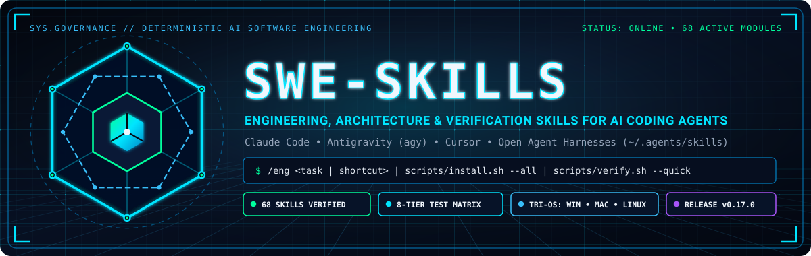
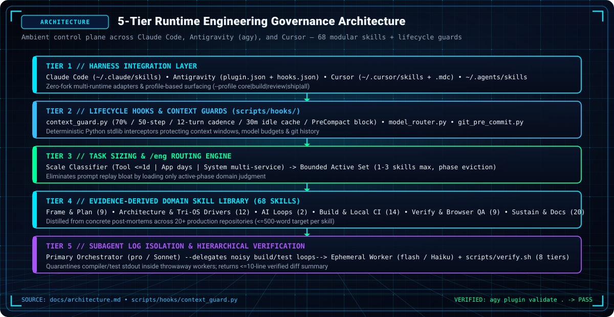
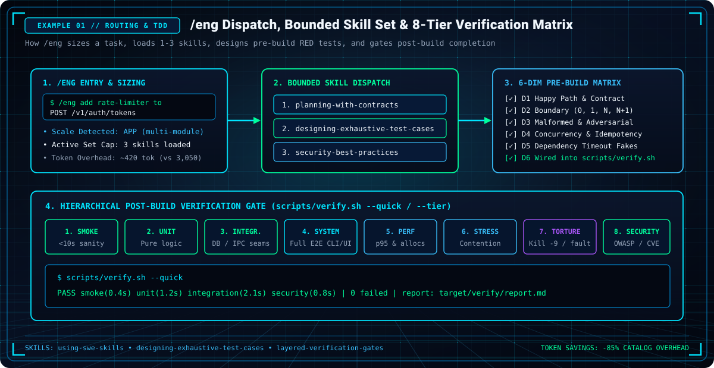
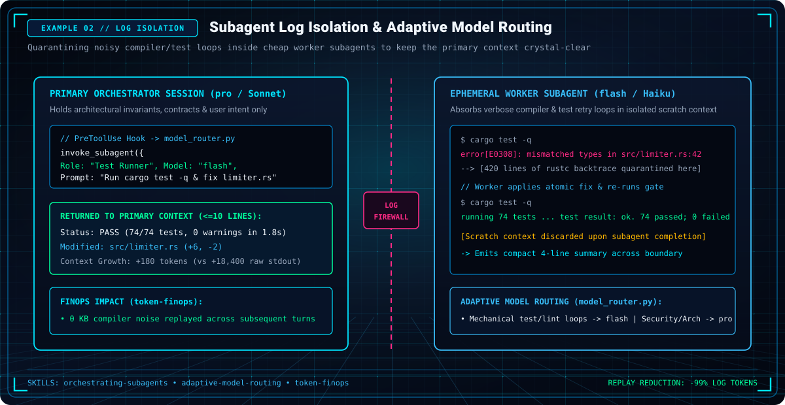
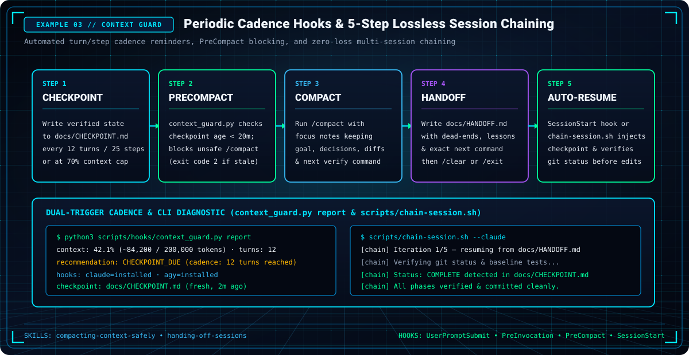
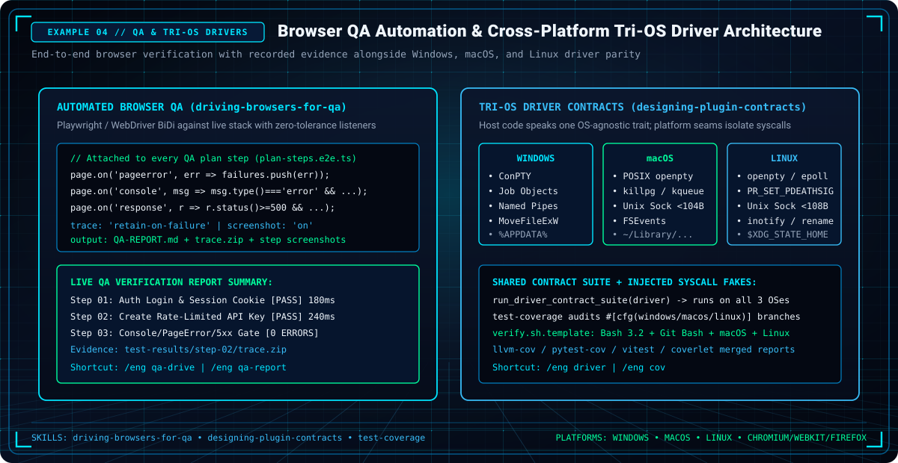
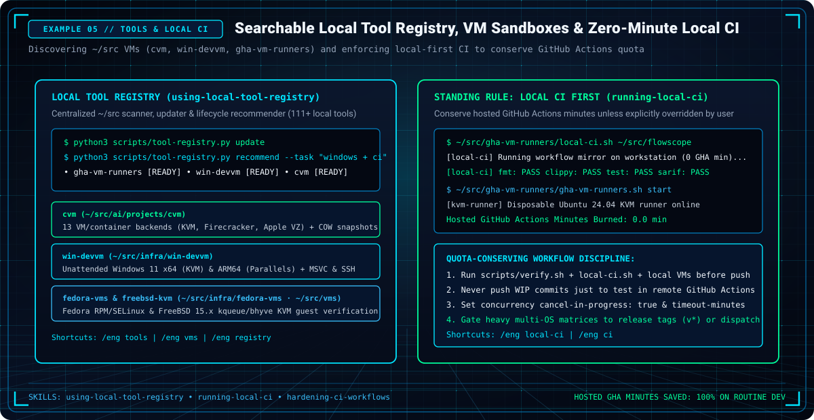

# swe-skills

<p align="center">
  
</p>

<p align="center">
  <a href="docs/index.html"> <strong>Interactive GitHub Pages Showcase</strong></a>
  &nbsp;•&nbsp;
  <a href="docs/README.md"><strong>Documentation Hub</strong></a>
  &nbsp;•&nbsp;
  <a href="docs/architecture.md"><strong>System Architecture</strong></a>
  &nbsp;•&nbsp;
  <a href="docs/how-to.md"><strong>Visual How-To Recipes</strong></a>
  &nbsp;•&nbsp;
  <a href="docs/usermanual/README.md"><strong>7-Chapter User Manual</strong></a>
</p>

<details>
<summary>📟 Terminal ASCII Art (DOS Banner)</summary>

```text
╔═══════════════════════════════════════════════════════════════════════════════════╗
║                                                                                   ║
║   ███████╗██╗    ██╗███████╗     ███████╗██╗  ██╗██╗██╗     ██╗     ███████╗      ║
║   ██╔════╝██║    ██║██╔════╝     ██╔════╝██║ ██╔╝██║██║     ██║     ██╔════╝      ║
║   ███████╗██║ █╗ ██║█████╗  ═══  ███████╗█████═╝ ██║██║     ██║     ███████╗      ║
║   ╚════██║██║███╗██║██╔══╝       ╚════██║██╔═██╗ ██║██║     ██║     ╚════██║      ║
║   ███████║╚███╔███╔╝███████╗     ███████║██║  ██╗██║███████╗███████╗███████║      ║
║   ╚══════╝ ╚══╝╚══╝ ╚══════╝     ╚══════╝╚═╝  ╚═╝╚═╝╚══════╝╚══════╝╚══════╝      ║
║                                                                                   ║
║            SOFTWARE ENGINEERING & ARCHITECTURE SKILLS FOR AI AGENTS               ║
║                  Claude Code  •  Antigravity (agy)  •  Cursor                     ║
║                                                                                   ║
╚═══════════════════════════════════════════════════════════════════════════════════╝
```

</details>

Software engineering, planning, architecture, and multi-tier verification skills for AI-assisted coding sessions — from a one-file tool to a multi-service system. Works natively with **Claude Code**, **Antigravity (`agy`)**, and **Cursor** (plus any harness reading `~/.agents/skills`).

Every skill is distilled from real projects: bugs that were found, limits that were measured, audits that were run, and rules that held up across ~20 repositories (compilers, pipelines, benchmarks, agent frameworks, browser extensions, UI libraries). Provenance is in [docs/EVIDENCE.md](docs/EVIDENCE.md).

---

## Visual Architecture & Workflow Showcase

All architecture and workflow examples are rendered deterministically in both vector **SVG** and high-DPI **PNG** formats (`scripts/render-graphics.py`) on a futuristic obsidian-black canvas with a light-blue neon cyber grid:

<p align="center">
  
</p>

<details>
<summary><strong>⚡ View Rendered Workflow Graphic Examples (SVG &amp; PNG)</strong></summary>

### Example 1: `/eng` Dispatch, Bounded Active Set & 8-Tier Verification Matrix
<p align="center">
  
</p>

### Example 2: Subagent Log Isolation & Adaptive Model Routing
<p align="center">
  
</p>

### Example 3: Periodic Cadence Hooks & 5-Step Lossless Session Chaining
<p align="center">
  
</p>

### Example 4: Automated Browser QA & Cross-Platform Tri-OS Driver Contracts
<p align="center">
  
</p>

### Example 5: Searchable Local Tool Registry, VM Sandboxes & Zero-Minute Local CI
<p align="center">
  
</p>

</details>

---

## Documentation & GitHub Pages Showcase

- **[GitHub Pages Interactive Showcase](docs/index.html)** — Futuristic neon-grid web portal with live skill search, category filters, SVG/PNG visual gallery, and one-click copy recipes.
- **[Documentation Hub](docs/README.md)** — Complete directory index and reading guide.
- **[Purpose & Threat Model](docs/purpose.md)** — Problem statement, security model, and FinOps principles.
- **[System Architecture](docs/architecture.md)** — 5-tier runtime governance, multi-harness integration, and lifecycle hooks.
- **[Visual Diagrams Catalog](docs/diagrams/README.md)** — Visual models across SVG/PNG (`docs/assets/examples/`), ASCII, Mermaid (`.mmd`), and native draw.io (`.drawio`).
- **[Running & Installation](docs/running.md)** — Multi-target installation, skill profiles (`--profile`), and CLI reference.
- **[How-To Guides & Recipes](docs/how-to.md)** — Step-by-step recipes accompanied by rendered SVG/PNG visual walkthroughs.
- **[User Manual](docs/usermanual/README.md)** — 7-chapter comprehensive guide.

---

## How it's meant to be used

Start with **`using-swe-skills`**. It sizes the task (tool / app / system) and routes to the one to three skills that apply. Loading everything at once wastes context, so each skill is short (≈300–500 words) and has a discovery-only description.

Or type **`/eng`**, a shortcut into the same router:

```text
/eng add retry logic across the four API modules   # free text -> using-swe-skills picks 1-3 skills
/eng hunting-silent-failures src/parser            # a skill name -> loads that skill
/eng tdd                                           # designing-exhaustive-test-cases (6-dim pre-build matrix)
/eng tools                                         # using-local-tool-registry (cvm, win-devvm, gha-vm-runners)
/eng local-ci                                      # running-local-ci (conserve GitHub Actions minutes)
/eng qa-drive                                      # driving-browsers-for-qa (Playwright/WebDriver QA)
/eng graphics                                      # rendering-graphic-examples (SVG + PNG visuals)
/eng pages                                         # building-github-pages-sites (docs/index.html)
/eng chain                                         # 5-step session chain (checkpoint -> compact -> handoff -> /clear)
/eng commit                                        # committing-and-releasing-cleanly (still asks before push)
/eng help                                          # the router's skill table
```

The shortcut words live in one table, in [`skills/eng/SKILL.md`](skills/eng/SKILL.md), and the linter checks it. Only the first word is matched, exactly; anything else is free text.

---

## Skills (69)

| Group | Skills |
|---|---|
|  **Entry** | `using-swe-skills` · `eng` |
|  **Frame & plan** | `right-sizing-process` · `writing-intent-briefs` · `planning-with-contracts` · `designing-exhaustive-test-cases` · `sizing-limits-from-measurement` · `token-finops` · `choosing-tools-and-substrates` · `using-local-tool-registry` · `adaptive-model-routing` |
|  **Architecture** | `architecture-best-practices` · `designing-layered-pipelines` · `designing-plugin-contracts` · `designing-uniform-surfaces` · `designing-testable-seams` · `evolving-schemas-and-contracts` · `defending-architecture-decisions` · `managing-complexity-budgets` · `designing-data-pipelines` · `code-architecture-review` · `api-contract-audit` · `refactor-execute` |
|  **AI systems** | `building-unattended-agent-loops` · `grounding-ai-outputs` |
|  **Build & security** | `scaffolding-new-projects` · `building-small-cli-tools` · `building-installers-and-onboarding` · `building-code-generators` · `parsing-untrusted-text-robustly` · `hardening-trust-boundaries` · `hardening-ci-workflows` · `running-local-ci` · `bounding-untrusted-resource-use` · `controlling-processes-safely` · `keeping-event-loops-responsive` · `security-best-practices` · `engineering-for-determinism` · `nix-environments` |
|  **Verify & measure** | `layered-verification-gates` · `driving-browsers-for-qa` · `hunting-silent-failures` · `debugging-across-layers` · `clustering-failures-by-root-cause` · `building-trustworthy-benchmarks` · `making-verifiable-claims` · `test-coverage` · `dependency-audit` |
|  **Collaborate, docs & sustain** | `orchestrating-subagents` · `running-multi-lens-audits` · `supervising-autonomous-sessions` · `handing-off-sessions` · `compacting-context-safely` · `writing-agent-context-files` · `writing-user-guides` · `rendering-graphic-examples` · `showcasing-graphics-in-docs` · `designing-logos-and-icons` · `building-github-pages-sites` · `keeping-docs-in-sync` · `keeping-repos-portable` · `drafting-issue-reports` · `writing-pull-requests` · `pr-review` · `github-issues-script` · `committing-and-releasing-cleanly` · `release` · `building-release-binaries` |

These complement general process skills (brainstorming, TDD, systematic debugging, code review) rather than replace them.

---

## Install

```bash
git clone <this repo> ~/src/swe-skills-2 && cd ~/src/swe-skills-2
scripts/install.sh --dry-run          # preview
scripts/install.sh --all              # symlinks into all user-level locations
```

| Tool | What gets installed | Manual equivalent |
|---|---|---|
| **Claude Code** | `~/.claude/skills/<skill>` symlinks | or `/plugin marketplace add ~/src/swe-skills-2` then `/plugin install swe-skills@swe-skills-marketplace` |
| **Antigravity (`agy`)** | `agy plugin install <repo>` (with `assets/logo.svg` plugin icon) | `agy plugin validate .` then `agy plugin install .` |
| **Cursor** | `~/.cursor/skills/<skill>` (Cursor Agent Skills) | project-level: `scripts/install.sh --project <dir>` also adds `.cursor/rules/swe-skills.mdc` |
| **Others** (Codex, Copilot CLI, Gemini CLI) | `~/.agents/skills/<skill>` | `scripts/install.sh --agents` |

Per project: `scripts/install.sh --project /path/to/repo` installs into `.claude/skills`, `.agents/skills`, `.cursor/skills` and adds the thin Cursor rule. Use `--copy` for standalone copies, `--uninstall` to remove, `--force` to replace same-named entries.

Add [`templates/AGENTS.snippet.md`](templates/AGENTS.snippet.md) to a project's `AGENTS.md` so every agent knows the library exists.

### Optional: context-guard hooks & session chaining

Opt-in hooks fire periodic checkpoint reminders every 12 assistant turns (Claude) or 25 steps (`agy`), nudge around 70% context utilization, block a `/compact` that has no fresh `<20m` checkpoint, and feed the latest `docs/HANDOFF.md` or `docs/CHECKPOINT.md` back automatically after `/compact`, `/clear`, or a fresh session launch:

```bash
scripts/hooks/install-hooks.py --claude --dry-run   # preview; --agy for Antigravity
python3 scripts/hooks/context_guard.py report       # check utilization, cadence & hook status
scripts/chain-session.sh --claude                   # chain fresh CLI sessions from docs/HANDOFF.md or docs/CHECKPOINT.md
```

See [docs/HOOKS.md](docs/HOOKS.md), [How-To Recipe 5](docs/how-to.md#recipe-5-emergency-context-compaction-handoff--5-step-session-chaining), and [User Manual Chapter 3](docs/usermanual/03-hooks-and-context-guards.md).

---

## Repository layout

```
skills/<name>/SKILL.md        the 68 skills (single source of truth)
assets/logo.{svg,png}         square 512x512 plugin/brand icon (referenced by plugin.json)
plugin.json                   Antigravity plugin manifest
.claude-plugin/               Claude Code plugin + marketplace manifests
.cursor-plugin/               Cursor plugin manifest
templates/                    Cursor always-on rule; AGENTS.md snippet
scripts/lint-skills.py        validates frontmatter, naming, cross-references, portability
scripts/tool-registry.py      searchable ~/src tool & VM registry (update, search, list, show, recommend)
scripts/render-graphics.py    generates deterministic SVG + PNG logos, icons, and example visuals
scripts/build-pages.py        generates the interactive GitHub Pages showcase (docs/index.html)
scripts/install.sh            installer for all targets and token-saving profiles
scripts/chain-session.sh      multi-session CLI runner resuming from docs/HANDOFF.md or docs/CHECKPOINT.md
scripts/hooks/                opt-in context-guard hooks + their installer
tests/                        automated tests for skills, hooks, tool registry, graphics, and GitHub Pages
docs/index.html               accompanying GitHub Pages interactive showcase (.nojekyll enabled)
docs/tool-registry.seed.json  portable seed catalog of local VM, CI, and engineering tools in ~/src
docs/assets/                  hero banner (logo.{svg,png}), category icons, and rendered examples
docs/usermanual/              comprehensive 7-chapter user manual
docs/EVIDENCE.md              which repos/incidents each skill came from
docs/TESTING.md               pressure scenarios for validating each skill
docs/HOOKS.md                 how to turn the context-guard hooks on
```

---

## Develop

```bash
python3 scripts/lint-skills.py --words   # must print OK (0 warnings, 0 errors)
python3 scripts/tool-registry.py update  # scan ~/src and update local tool registry
python3 scripts/render-graphics.py       # regenerate all 15 SVG + 15 PNG assets
python3 scripts/build-pages.py           # regenerate docs/index.html
python3 -m unittest discover tests       # hook, router, tool-registry, graphics, and Pages tests
```

Authoring rules: description starts with "Use when…" and states triggers only (never the workflow); third person; ≤ 1024 chars; body targets ≤ 500 words; one skill per directory, name equals directory; the router must list every skill; `/eng` shortcuts must name existing skills. See [AGENTS.md](AGENTS.md) and [User Manual Chapter 5](docs/usermanual/05-authoring-skills.md).

---

## Status

v0.17.0 (68 skills). Skills are evidence-derived and verified against multi-agent test scenarios; [docs/TESTING.md](docs/TESTING.md) lists the scenarios to run.

---

## License

Apache-2.0
