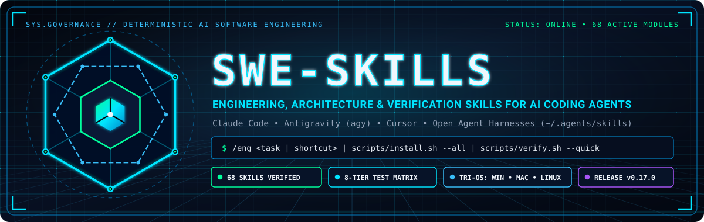

# swe-skills Documentation Hub

<p align="center">
  
</p>

Welcome to the comprehensive documentation suite for **swe-skills** — the 68-skill engineering, architecture, and verification library designed for autonomous and paired AI coding agents (**Claude Code**, **Antigravity (`agy`)**, and **Cursor**).

> 🌐 **Interactive Web Showcase:** Open [`docs/index.html`](index.html) (or visit the repository's GitHub Pages site) for an interactive skill explorer, category filter tabs, and SVG/PNG visual gallery.

---

## Documentation Navigation

```
docs/
├── index.html              # Accompanying GitHub Pages interactive web showcase
├── .nojekyll               # Disables Jekyll preprocessing so assets serve cleanly
├── README.md               # You are here: central navigational index
├── purpose.md              # Problem statement, threat model, token economics, principles
├── architecture.md         # 5-tier architecture, lifecycle hooks, routing, subagent isolation
├── running.md              # Installation guide, profile management, CLI tools, env vars
├── how-to.md               # Step-by-step recipes with rendered SVG/PNG visual walkthroughs
├── AGENT_AUTONOMY_AND_PERMISSIONS.md # Super-permissive autonomy & canonical permission policies
├── HOOKS.md                # Periodic cadence hooks, PreInvocation, PreCompact, model routing
├── EVIDENCE.md             # Empirical provenance and incident history across 20+ codebases
├── TESTING.md              # Pressure testing scenarios and benchmark evaluation
├── assets/                 # Futuristic neon-grid SVG + PNG brand & example visuals
│   ├── logo.{svg,png}      # Wide 1200x380 hero banner
│   ├── icon.{svg,png}      # Square 512x512 cyber-core emblem
│   ├── icons/              # 64x64 category vector & raster badges (entry, plan, arch, build, verify, sustain)
│   └── examples/           # 1200x620 rendered architecture & workflow examples (.svg + .png)
├── diagrams/               # Multi-format architectural visual models
│   ├── README.md           # Diagram viewing & editing guide
│   ├── ascii_architecture.txt # Terminal-friendly ASCII schematics
│   ├── *.mmd               # Standalone Mermaid diagrams (flowcharts, sequence, state)
│   └── *.drawio            # Native draw.io XML vector diagrams
└── usermanual/             # 7-chapter comprehensive user guide
    ├── README.md
    ├── 01-getting-started.md
    ├── 02-skills-catalog.md
    ├── 03-hooks-and-context-guards.md
    ├── 04-workflows-and-recipes.md
    ├── 05-authoring-skills.md
    ├── 06-reference-and-cli.md
    └── 07-troubleshooting-and-faq.md
```

---

## Core Reading Order

1. **New to swe-skills?** Read [Purpose & Motivation](purpose.md) to understand the systemic failure modes that LLM agents encounter without software engineering discipline.
2. **Installation & Profiles:** Follow [Running & Installation](running.md) to install skills with targeted profiles (`core`, `build`, `review`, `ship`, `all`) and save ~85% in prompt catalog tokens.
3. **Architecture & Internal Design:** Study [Architecture](architecture.md) and explore the visual models in [Rendered Examples](assets/examples/architecture-overview.svg) and [Diagrams](diagrams/README.md).
4. **Hands-On Visual Recipes:** Follow [How-To Guides](how-to.md) for concrete recipes accompanied by rendered SVG/PNG diagrams covering `/eng` routing, subagent log isolation, 5-step session chaining, and automated browser QA.
5. **Detailed User Manual:** Dive into the [7-Chapter User Manual](usermanual/README.md) for exhaustive reference material.
