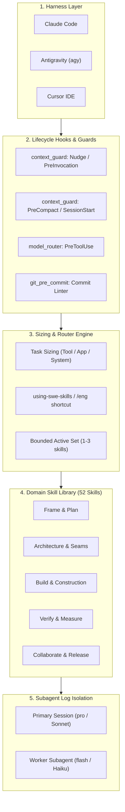
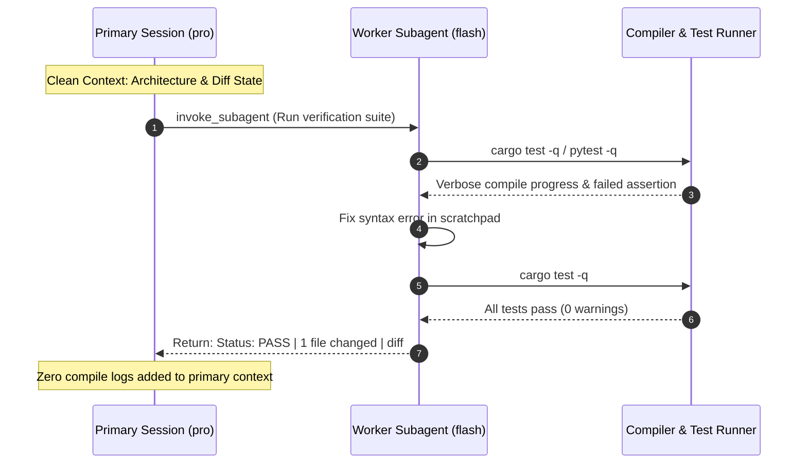

# Architecture & Internal Design

`swe-skills` operates as a layered engineering governance framework running inside AI coding harnesses. It acts as an ambient runtime governor, ensuring that coding agents maintain architectural boundaries, respect token budgets, and apply rigorous verification.

---

## 1. High-Level Architecture

The system is composed of five distinct tiers:

> Visual models available in multiple formats in [`docs/diagrams/`](diagrams/README.md):
> - Terminal ASCII: [`docs/diagrams/ascii_architecture.txt`](diagrams/ascii_architecture.txt)
> - Standalone Mermaid: [`docs/diagrams/architecture.mmd`](diagrams/architecture.mmd)
> - Native draw.io XML: [`docs/diagrams/architecture.drawio`](diagrams/architecture.drawio)

---

## 2. Subsystem Deep-Dives

### Subsystem A: Multi-Harness Integration Layer
`swe-skills` adapts natively to three leading agent runtime environments without code forks:

1. **Claude Code**:
   - Discovers skills via symlinks in `~/.claude/skills/<name>`.
   - Injects lifecycle hooks into `~/.claude/settings.json` (`UserPromptSubmit`, `PreCompact`, `SessionStart`).
2. **Antigravity (`agy`)**:
   - Integrates via root `plugin.json` and `hooks.json`.
   - Discovers skills directly from `skills/`.
   - Utilizes `PreInvocation` for transcript monitoring and `PreToolUse` for dynamic subagent model routing.
3. **Cursor IDE**:
   - Symlinks skills to `~/.cursor/skills/` and generates project-level rules at `.cursor/rules/swe-skills.mdc`.
4. **Cross-Runtime Alias**:
   - Maintains `~/.agents/skills/` for tools supporting the open agent specification (Gemini CLI, Codex, Copilot CLI).

---

### Subsystem B: Lifecycle & Context Guard Subsystem
Located in `scripts/hooks/`, these lightweight, standard-library Python scripts execute at key lifecycle interception points:

- **`context_guard.py`**:
  - `nudge` / `preinvocation`: Analyzes cumulative token consumption and turn count. When context exceeds 70% (Claude) or 50 steps / 500 KB (Antigravity), or when resuming after an idle gap >30 minutes (where the 5-minute prompt cache has expired), it injects an urgent checkpoint and compaction reminder.
  - `precompact`: Blocks manual `/compact` commands if no verified disk checkpoint was touched in the last 20 minutes (exit code 2). Prevents accidental loss of uncommitted work or user corrections.
  - `sessionstart`: Runs upon session startup or resumption. Injects the latest checkpoint file, requiring the agent to verify working-tree claims before generating code.
- **`model_router.py`**:
  - Intercepts `invoke_subagent` calls via `PreToolUse`. Inspects the role, prompt, and file paths. If high-complexity keywords (`architect`, `audit`, `security`, `race condition`) or security-sensitive paths (`auth`, `crypto`, `types/`) are detected, it dynamically enforces `Model: "pro"`; for routine, mechanical tasks, it routes to `Model: "flash_lite"`.
- **`git_pre_commit.py`**:
  - Git hook that verifies skill word limits, prevents unmasked API keys or secrets from entering commits, checks manifest version consistency, and forbids hardcoded absolute machine paths.

---

### Subsystem C: Discovery & Routing Engine
The discovery engine prevents context saturation by strictly sizing tasks and routing to minimal skill subsets:

1. **Task Sizing Matrix**:
   - **Tool** ($\le 1$ day, single purpose): Minimal overhead. 3-line intent brief, standard library only, 1 happy + 1 failure test.
   - **App** (multiple modules, state/UI, days): Structured tasks, contract planning, explicit verification commands.
   - **System** (multi-service, unattended, shared dependencies): Full architectural rigor. ADRs, API contracts, FinOps budgets, multi-lens audits.
2. **Bounded Active Set & Eviction**:
   - Agents must never load more than 1–3 skills into active memory simultaneously.
   - **Phase Eviction**: When shifting from planning to implementation, or from implementation to release, agents must checkpoint and drop prior skill text, preventing multi-turn prompt bloat.
3. **The `/eng` Shortcut**:
   - A single unified entrypoint matching exact shortcut words (e.g. `/eng commit`, `/eng pr`, `/eng test`) or routing free text into [`using-swe-skills`](../skills/using-swe-skills/SKILL.md).

---

### Subsystem D: Subagent Log Isolation Pattern

By delegating iterative build/test/lint loops to ephemeral worker subagents running on fast tiers (`flash` / `haiku`), hundreds of routine progress lines (`Compiling <crate>`, `test ... ok`) are quarantined in throwaway scratch contexts. The primary orchestrator receives only the final verified diff and a $\le 10$-line summary, eliminating the primary driver of token bloat.
