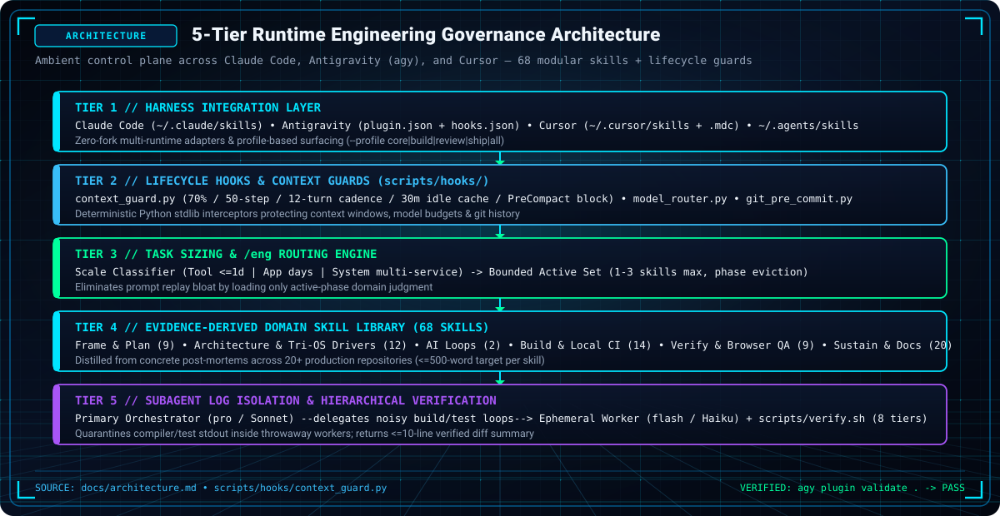
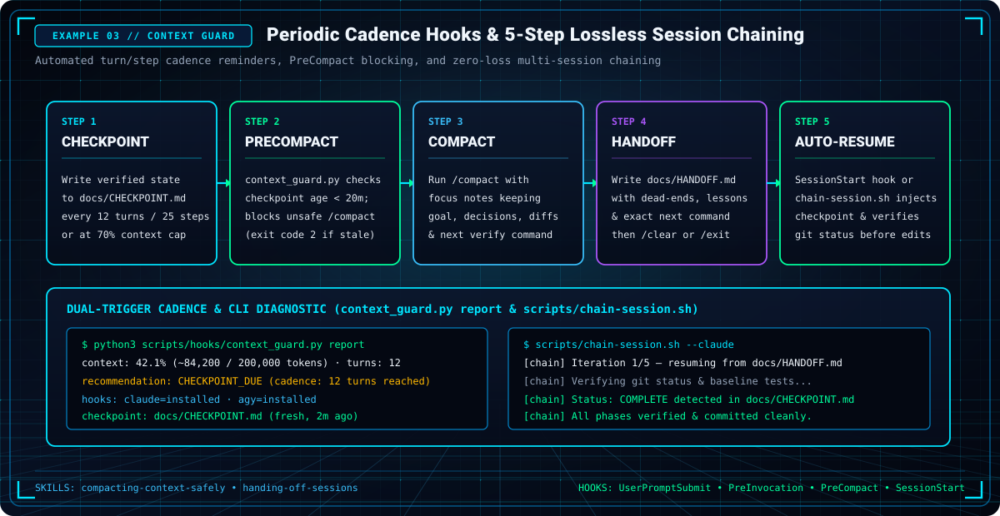
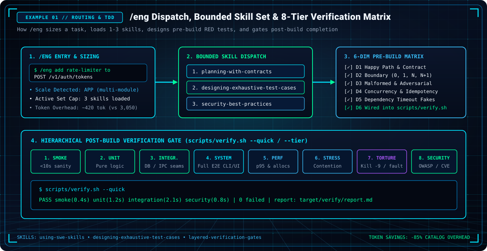
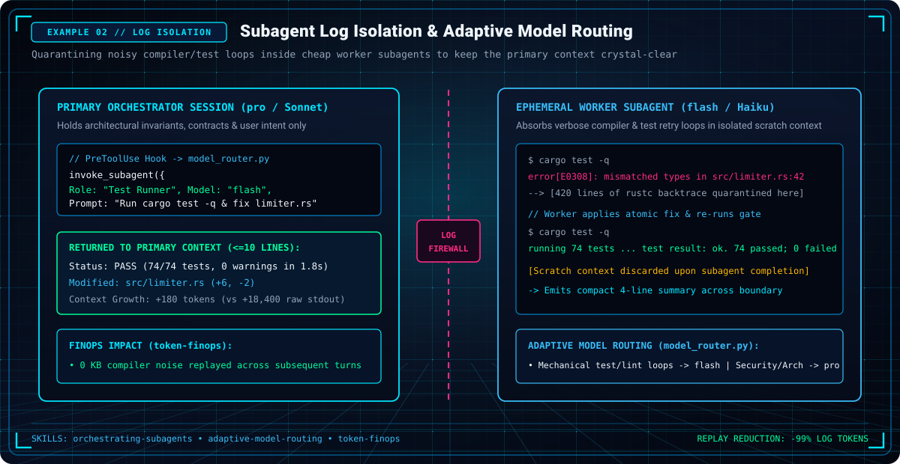
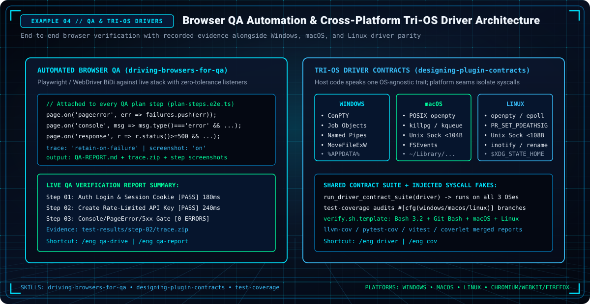
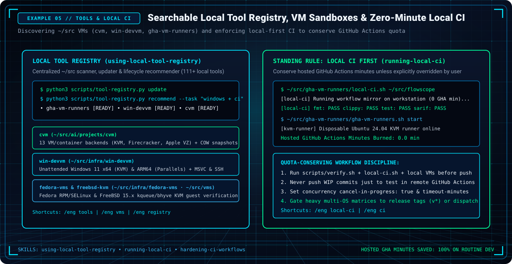

# Architecture & Internal Design

`swe-skills` operates as a layered engineering governance framework running inside AI coding harnesses. It acts as an ambient runtime governor, ensuring that coding agents maintain architectural boundaries, respect token budgets, design exhaustive pre-build test cases, and apply rigorous multi-tier verification.

---

## 1. High-Level Architecture

  

The system is composed of five distinct tiers:

```mermaid
flowchart TD
    subgraph HarnessLayer["1. Harness Layer"]
        Claude["Claude Code"]
        Agy["Antigravity (agy)"]
        Cursor["Cursor IDE"]
    end

    subgraph HookLayer["2. Lifecycle Hooks & Guards"]
        Nudge["context_guard: Nudge / PreInvocation / Cadence"]
        CompGuard["context_guard: PreCompact / SessionStart"]
        RouterGuard["model_router: PreToolUse"]
        GitGuard["git_pre_commit: Commit Linter"]
    end

    subgraph RoutingLayer["3. Sizing & Router Engine"]
        Sizer["Task Sizing (Tool / App / System)"]
        Router["using-swe-skills / /eng shortcut"]
        ActiveSet["Bounded Active Set (1-3 skills)"]
    end

    subgraph SkillTaxonomy["4. Domain Skill Library (69 Skills)"]
        FramePlan["Entry, Frame, Plan, Tools & Test Matrix (11)"]
        ArchDomain["Architecture & Tri-OS Drivers (12)"]
        BuildDomain["Build, AI Loops, Security & Local CI (17)"]
        VerifyDomain["Verify, Coverage & Browser QA (9)"]
        CollabDomain["Collaborate, Docs, Graphics & Release (20)"]
    end

    subgraph IsolationLayer["5. Subagent Log Isolation & 8-Tier Runner"]
        Primary["Primary Session (pro / Sonnet)"]
        Worker["Worker Subagent (flash / Haiku)"]
        VerifySh["scripts/verify.sh (8 Tiers)"]
    end

    HarnessLayer --> HookLayer
    HookLayer --> RoutingLayer
    RoutingLayer --> SkillTaxonomy
    SkillTaxonomy --> IsolationLayer
```

> Visual models available in multiple formats:
> - Rendered Neon-Grid SVG & Hi-DPI PNG: [`docs/assets/examples/`](assets/examples/architecture-overview.svg)
> - Terminal ASCII: [`docs/diagrams/ascii_architecture.txt`](diagrams/ascii_architecture.txt)
> - Standalone Mermaid: [`docs/diagrams/architecture.mmd`](diagrams/architecture.mmd)
> - Native draw.io XML: [`docs/diagrams/architecture.drawio`](diagrams/architecture.drawio)

---

## 2. Subsystem Deep-Dives

### Subsystem A: Multi-Harness Integration Layer
`swe-skills` adapts natively to leading agent runtime environments without code forks:

1. **Claude Code**:
   - Discovers skills via symlinks in `~/.claude/skills/<name>`.
   - Injects lifecycle hooks into `~/.claude/settings.json` (`UserPromptSubmit`, `PreCompact`, `SessionStart`).
2. **Antigravity (`agy`)**:
   - Integrates via root `plugin.json` (with `"logo": "assets/logo.svg"`) and `hooks.json`.
   - Discovers skills directly from `skills/`.
   - Utilizes `PreInvocation` for transcript monitoring and `PreToolUse` for dynamic subagent model routing.
3. **Cursor IDE**:
   - Symlinks skills to `~/.cursor/skills/` and generates project-level rules at `.cursor/rules/swe-skills.mdc`.
4. **Cross-Runtime Alias**:
   - Maintains `~/.agents/skills/` for tools supporting the open agent specification (Gemini CLI, Codex, Copilot CLI).

---

### Subsystem B: Lifecycle & Periodic Context Guard Subsystem

  

Located in `scripts/hooks/`, these lightweight, standard-library Python scripts execute across Windows, macOS, and Linux at key lifecycle interception points:

- **`context_guard.py`**:
  - **Periodic Cadence Reminders (`nudge` / `preinvocation`):** Fires a lightweight checkpoint reminder every `12` assistant turns in Claude (`SWE_SKILLS_CHECKPOINT_CADENCE_TURNS=12`) or every `25` steps in Antigravity (`SWE_SKILLS_CHECKPOINT_CADENCE_STEPS=25`) whenever no fresh checkpoint (`< 20` min) exists on disk.
  - **Capacity & Cold-Cache Guards (`nudge` / `preinvocation`):** When context exceeds 70% (Claude) or 50 steps / 500 KB (Antigravity), or when resuming after an idle gap >30 minutes (where the 5-minute prompt cache has expired), it injects an urgent checkpoint and compaction reminder.
  - **`precompact`:** Blocks manual `/compact` commands if no verified disk checkpoint was touched in the last 20 minutes (exit code 2).
  - **`sessionstart`:** Runs upon session startup or resumption. Injects the latest `docs/HANDOFF.md` or `docs/CHECKPOINT.md` file, requiring the agent to verify working-tree claims before generating code.
  - **`report`:** Outputs current utilization, turn count, `recommendation:` (`OK`, `CHECKPOINT_DUE`, `COMPACT_OR_RESET_NOW`), and `hooks:` installation status.
- **`model_router.py`**:
  - Intercepts `invoke_subagent` calls via `PreToolUse`. Inspects the role, prompt, and file paths. Routes high-complexity architecture/security tasks to `Model: "pro"` and mechanical tasks to `Model: "flash_lite"` or `"flash"`.
- **`git_pre_commit.py`**:
  - Git hook that verifies skill word limits, prevents unmasked secrets or duplicate `docs/CHANGELOG.md` files from entering commits, checks manifest version consistency, and forbids hardcoded absolute machine paths.

---

### Subsystem C: Discovery, Routing & Pre-Build Test Matrix Engine

  

The discovery engine prevents context saturation by strictly sizing tasks and routing to minimal skill subsets:

1. **Task Sizing Matrix**:
   - **Tool** ($\le 1$ day, single purpose): Minimal overhead. 3-line intent brief, standard library only, 1 happy + 1 failure test.
   - **App** (multiple modules, state/UI, days): Structured tasks, contract planning, pre-build exhaustive test matrix, explicit verification commands.
   - **System** (multi-service, unattended, shared dependencies): Full architectural rigor. ADRs, API contracts, FinOps budgets, multi-lens audits.
2. **Bounded Active Set & Eviction**:
   - Agents load at most 1–3 skills into active memory simultaneously and evict prior-phase skills at phase boundaries.
3. **The `/eng` Shortcut**:
   - Unified entrypoint matching exact shortcut words (e.g. `/eng tdd`, `/eng qa-drive`, `/eng graphics`, `/eng pages`, `/eng commit`) or routing free text into [`using-swe-skills`](../skills/using-swe-skills/SKILL.md).

---

### Subsystem D: Subagent Log Isolation Pattern

  

By delegating iterative build/test/lint loops to ephemeral worker subagents running on fast tiers (`flash` / `haiku`), hundreds of routine progress lines (`Compiling <crate>`, `test ... ok`) are quarantined in throwaway scratch contexts. The primary orchestrator receives only the final verified diff and a $\le 10$-line summary, eliminating the primary driver of token bloat.

---

### Subsystem E: Cross-Platform Tri-OS Drivers & Browser QA

  

- **Tri-OS Driver Contracts (`designing-plugin-contracts`, `test-coverage`):** Host code speaks an OS-agnostic interface while platform backends isolate Windows (`ConPTY`, `Job Objects`, `Named Pipes`, `MoveFileExW`), macOS (`openpty`, `kqueue`, `<104B` Unix sockets), and Linux (`openpty`, `epoll`, `PR_SET_PDEATHSIG`) behind injected syscall seams tested by a shared contract suite.
- **Automated Browser QA (`driving-browsers-for-qa`):** Drives real browser sessions (Playwright, Selenium 4 / WebDriver BiDi, Puppeteer) against live services with zero-tolerance listeners for `pageerror`, `console.error`, and HTTP `5xx` responses, emitting `QA-REPORT.md` plus trace and screenshot artifacts.

---

### Subsystem F: Searchable Local Tool Registry & Local-First CI

  

- **Centralized Local Tool Registry (`scripts/tool-registry.py`, `using-local-tool-registry`):** Scans `~/src` and merges curated definitions (`docs/tool-registry.seed.json`) into `~/.local/share/swe-skills/tool-registry.json`. Agents run `recommend --task "..."` or `search` to discover local VM sandboxes (`cvm`), unattended Windows 11 KVM/Parallels VMs (`win-devvm`), Fedora/FreeBSD guests (`fedora-vms`, `freebsd-kvm`), local CI runners (`gha-vm-runners`), and SAST/benchmark tools (`flowscope`, `synth`, `eval`).
- **Standing Local-First CI Rule (`running-local-ci`, `hardening-ci-workflows`):** Hosted GitHub Actions minutes are conserved by default unless explicitly overridden by the user. Agents run `scripts/verify.sh`, `~/src/gha-vm-runners/local-ci.sh`, and local VMs before any `git push`.
