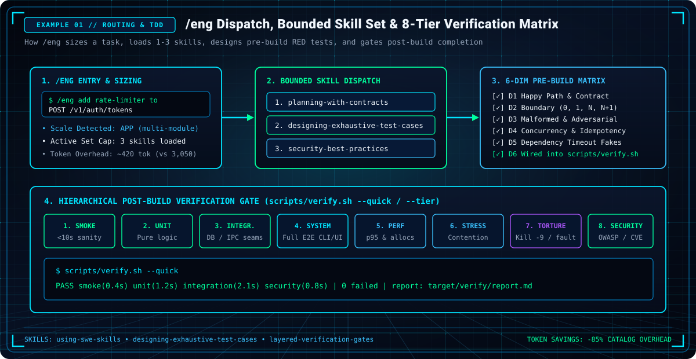
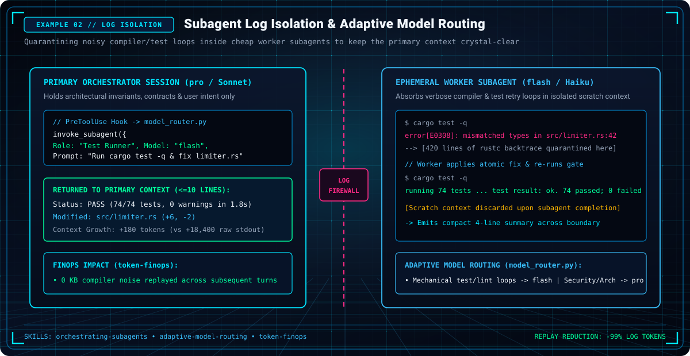
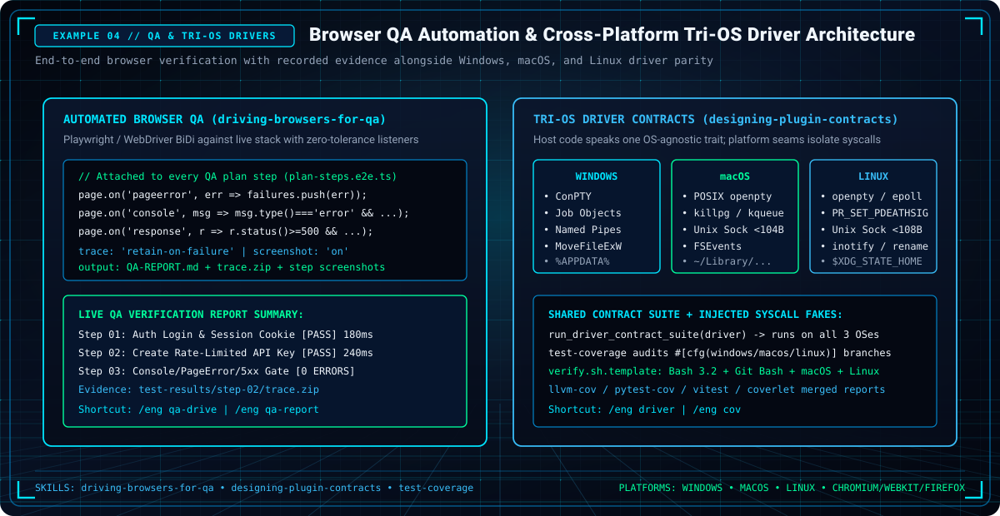
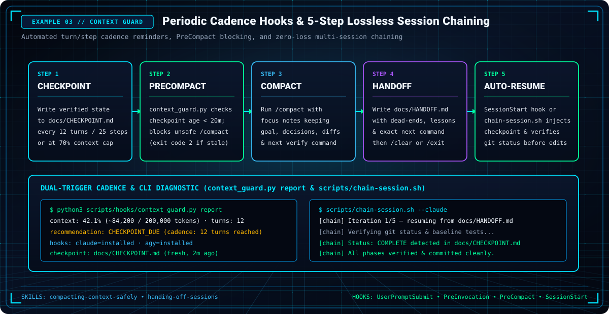
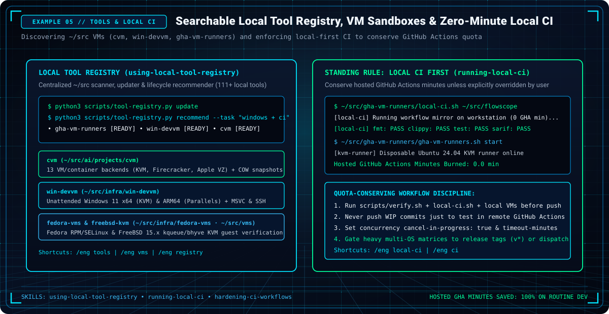

# How-To Guides & Operational Recipes

Practical, copy-pasteable recipes for applying `swe-skills` across common software engineering workflows, paired with rendered **SVG** and **PNG** visual walkthroughs.

---

## Recipe 1: Sizing, Planning & Pre-Build Exhaustive Test Matrix

<p align="center">
  
</p>

When starting any new feature, use `/eng` to route to the minimal necessary skills, design the 6-dimension pre-build test matrix, and wire post-build verification into `scripts/verify.sh`:

```text
/eng implement rate limiting on the POST /v1/auth/tokens endpoint
```

1. **Task Sizing:** The router classifies the change as **App** scale and loads `planning-with-contracts`, `designing-exhaustive-test-cases`, and `security-best-practices`.
2. **Pre-Build 6-Dimension Test Matrix (`designing-exhaustive-test-cases`):**
   - **D1 Happy Path:** Valid token issuance within burst/sustained quota (`unit`, `smoke`).
   - **D2 Boundaries:** `0`, `1`, `N`, `N+1` requests at window boundary (`unit`).
   - **D3 Adversarial/Malformed:** Spoofed `X-Forwarded-For`, negative headers, oversized payloads (`security`, `unit`).
   - **D4 Concurrency & Idempotency:** Parallel burst race condition across threads (`stress`).
   - **D5 Dependency Failure Fakes:** Backing store timeout/disconnect via injected seam (`integration`).
   - **D6 Post-Build Gate:** Tests written RED-first and wired into `scripts/verify.sh --quick`.
3. **Phase Eviction:** Once the plan and RED tests are written, evict planning skill text and implement to GREEN.

---

## Recipe 2: Subagent Log Isolation (Shielding Main Context)

<p align="center">
  
</p>

When executing iterative test or build cycles with high log verbosity, delegate to an ephemeral subagent to avoid poisoning the primary orchestrator context:

```json
{
  "tool": "invoke_subagent",
  "parameters": {
    "Role": "Test Runner",
    "Model": "flash",
    "Prompt": "Run `cargo test -q` in the repo root. If failures occur, fix compilation errors in `src/limiter.rs` without modifying public contracts. Return ONLY the pass/fail status and the resulting diff in <=10 lines."
  }
}
```

- **What Happens:**
  - The worker subagent absorbs dozens of `Compiling <crate>` lines and multiple test retry runs inside its own isolated context window.
  - The primary session receives only:
    ```text
    Status: ALL PASSED (74 passed, 0 warnings in 1.8s)
    Modified: src/limiter.rs (+6, -2)
    Diff: [compact diff]
    ```

---

## Recipe 3: Safe Multi-File Refactoring

To refactor code across modules without behavioral regression:

1. **Establish Green Baseline:**
   ```bash
   pytest -q  # Record exact passing count (e.g. 148 passed)
   ```
2. **Review Structural Graph:**
   Load `code-architecture-review` to inspect dependency couplings and circular imports.
3. **Execute in Atomic Slices (`refactor-execute`):**
   - Refactor one module at a time.
   - Re-run `pytest -q` after every atomic slice.
   - If tests fail, revert immediately (`git checkout -- <file>`) rather than stacking speculative fixes.
4. **Enforce Gate:** Run `layered-verification-gates` with zero warnings before committing.

---

## Recipe 4: Automated Browser QA & Cross-Platform Tri-OS Drivers

<p align="center">
  
</p>

1. **Drive a Live Browser QA Plan (`/eng qa-drive`):**
   - Uses `driving-browsers-for-qa` templates (`playwright.config.template.ts`, `plan-steps.e2e.template.ts`, `QA-REPORT.template.md`).
   - Attaches zero-tolerance listeners for `pageerror`, `console.error`, and HTTP `>= 500` responses, saving traces and step screenshots into `QA-REPORT.md`.
2. **Verify Cross-Platform Driver Parity (`/eng driver` & `/eng cov`):**
   - Isolates Windows (`ConPTY`, `Job Objects`, `Named Pipes`), macOS (`openpty`, `kqueue`), and Linux (`openpty`, `epoll`) behind an OS-agnostic host trait (`designing-plugin-contracts`) and audits OS-gated coverage (`test-coverage`).

---

## Recipe 5: Emergency Context Compaction, Periodic Cadence & 5-Step Session Chaining

<p align="center">
  
</p>

### Interactive 5-Step Chain (`Checkpoint -> Compact -> Handoff -> /clear -> Auto-Resume`)

1. **Write Initial Checkpoint (`/eng compact`):**
   Check status via `python3 scripts/hooks/context_guard.py report`, run verification, and write `docs/CHECKPOINT.md` (unlocks the `PreCompact` guard and satisfies periodic 12-turn / 25-step cadence).
2. **Compact with Focus Notes (Claude Code):**
   ```text
   /compact keep: goal, user decisions, uncommitted diffs, next step; checkpoint at docs/CHECKPOINT.md
   ```
3. **Write Final Handoff (`/eng handoff` or `/eng chain`):**
   Write `docs/HANDOFF.md` (or refresh `docs/CHECKPOINT.md`) with the post-compaction synthesis, discoveries/dead ends, and exact next command sequence.
4. **Reset Context (`/clear` or New Session):**
   - **Claude Code:** Run `/clear`.
   - **Antigravity (`agy`):** Exit (`/exit`, `Ctrl+D`, or **New Chat**), or spawn an in-session fresh-context `self` subagent.
5. **Automatic Chain Pickup (`SessionStart` Hook or `scripts/chain-session.sh`):**
   ```bash
   scripts/chain-session.sh --claude
   scripts/chain-session.sh --agy --once
   ```

---

## Recipe 6: Rendering SVG/PNG Graphic Examples & Building GitHub Pages

To generate or refresh the futuristic obsidian-black + light-blue neon grid logos, category icons, workflow visuals, and the accompanying GitHub Pages site (`/eng graphics`, `/eng logo`, `/eng showcase`, `/eng pages`):

```bash
# 1. Render all 15 vector SVGs and rasterize 15 Hi-DPI PNGs via Inkscape
python3 scripts/render-graphics.py

# 2. Rebuild docs/index.html and docs/.nojekyll from live skill metadata
python3 scripts/build-pages.py

# 3. Validate XML integrity, PNG headers, and zero broken links
python3 -m unittest discover tests -q
```

---

## Recipe 7: Local Tool Registry & Zero-Minute Local CI

<p align="center">
  
</p>

To query local VMs, sandboxes, and dev tools in `~/src` (`using-local-tool-registry`) and run the complete CI verification matrix locally before pushing so hosted GitHub Actions minutes are conserved (`running-local-ci`):

```bash
# 1. Refresh the searchable ~/src tool registry & recommend tools for your lifecycle phase
python3 scripts/tool-registry.py update
python3 scripts/tool-registry.py search "vm windows ci"
python3 scripts/tool-registry.py recommend --phase verify

# 2. Run the full verification suite locally (zero hosted GitHub Actions minutes)
~/src/gha-vm-runners/local-ci.sh /path/to/repo

# 3. Cross-OS verification in local VMs when needed
~/src/infra/win-devvm/vm.sh ssh "cd C:\\work && cargo test -q"
cvm run -- name=verify-linux "pytest -q"
```

---

## Troubleshooting Matrix

| Problem | Root Cause | Solution |
|---|---|---|
| `/compact` exits with code 2 in Claude Code | `precompact` hook blocked compaction because no checkpoint file was touched in the last 20 minutes. | Write or update `docs/CHECKPOINT.md` with current state, then re-run `/compact`. |
| `[context guard]` periodic cadence reminder fires | 12 assistant turns (Claude) or 25 steps (`agy`) elapsed without a fresh `<20m` checkpoint. | Refresh `docs/CHECKPOINT.md` at the current milestone boundary. |
| Tool runs produce thousands of tokens of compile progress | Missing quiet flags in build/test commands. | Always append quiet flags: `cargo test -q`, `cargo build -q`, `pytest -q`, `npm test -s`. |
| Git commit fails with `absolute path` error | A skill or test file contains hardcoded machine paths (e.g. `~username/...` or `C:\Users\...`). | Replace absolute machine paths with repo-relative paths (`./` or `$REPO_ROOT`). |
| System prompt token overhead is high (>3,000 tokens) | All 69 skills are mounted in user skill directory. | Run `scripts/install.sh --claude --profile core` to mount only the 11 essential core skills. |
