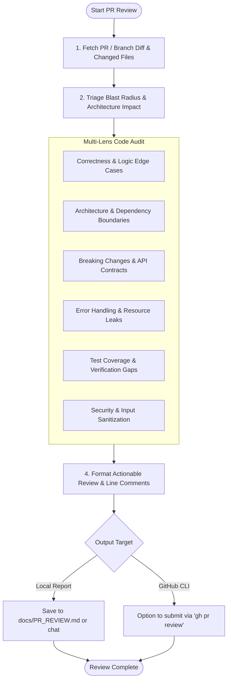

# Review workflow details

Moved from the skill body; behavior unchanged.

## Agent Detection & Mode Tuning

| Agent / Environment | PR Review Mechanism |
| :--- | :--- |
| **Antigravity (`agy`)** | Inspects git diffs via `run_command` or GitHub CLI (`gh pr diff`), analyzes changed files with `view_file`, and generates interactive review artifacts (`write_to_file` with `ArtifactMetadata`). |
| **Claude Code** | Parses `$ARGUMENTS` (e.g. `/pr-review`, `/pr-review 42`, `/pr-review feature-branch`), queries `gh pr diff`, and outputs structured markdown feedback. |
| **Cursor (Composer / Agent)** | Reviews staged changes or branch diffs against `main`, highlighting inline suggestions compatible with Cursor's multi-file editor. |
| **Universal AI Agents** | Standard git diff inspection (`git diff origin/main...HEAD`) with markdown reporting. |

---

## PR Review Workflow



---


## Step 4: Submitting via GitHub CLI (`gh`)

When the user requests submitting the review directly to GitHub:

```bash
# Submit review with comments
gh pr review <PR_NUMBER> --approve --body "LGTM! Approved with minor suggestions."
# Or request changes:
gh pr review <PR_NUMBER> --request-changes --body "<Review Markdown>"
# Or general comment:
gh pr review <PR_NUMBER> --comment --body "<Review Markdown>"
```

---


Posting to GitHub is a separate, explicit user decision. Never post from a review run unless asked; show the consolidated reply and the validator result instead.
