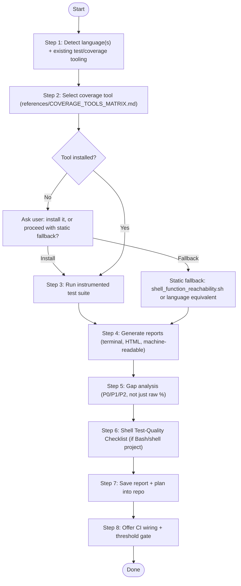

# Test Coverage & Suite Robustness Skill

Audits an existing test suite across **Windows, macOS, and Linux**, checks **tier completeness** (smoke, unit, integration, system, performance, stress, torture/chaos) and **composable runner wiring**, measures real coverage, gives advice on fixing failing tests, and produces a saved-to-repo plan for closing the highest-risk gaps first (`designing-exhaustive-test-cases`).

**Core principle:** coverage percentage is a proxy, not the goal. A codebase at 95% line coverage on Linux with only unit tests, unmocked external commands, and untested Windows/macOS driver branches is less safe than one exercising integration, system, saturation, and fault-injection paths across all target OSes (`designing-plugin-contracts`). To probe uncovered code for silent bugs, hand off to `hunting-silent-failures`.

---

## Agent Detection & Mode Tuning

Detect the active runtime environment. See `references/AGENT_TUNING.md` for tool selection and output conventions.

---

## Workflow Overview



---

## Step 1: Detect Language(s) & Existing Tooling

Inspect project manifests (`package.json`, `pyproject.toml`, `go.mod`, `Cargo.toml`, `pom.xml`, `build.gradle`, `Gemfile`, `*.csproj`, `composer.json`, `*.bats`). Check for existing configured tooling in CI or scripts before introducing new tools:
```bash
grep -rn "coverage\|kcov\|nyc\|c8\|pytest-cov\|tarpaulin\|jacoco\|coverlet" package.json pyproject.toml Makefile .github/workflows/*.yml 2>/dev/null
```

---

## Step 2: Select the Coverage Tool

Consult `references/COVERAGE_TOOLS_MATRIX.md` for tool selection. For **Bash/shell projects**, review `references/BASH_COVERAGE_NOTES.md` for kcov+bats failure modes.

### Installation Gate
If the selected tool is uninstalled, ask the user before installing:
> *"`<tool>` isn't installed. Install it via `<command>`, or proceed with static reachability fallback?"*

---

## Step 3: Run the Instrumented Suite

Run the language-specific tool across **Windows, macOS, and Linux** (`references/COVERAGE_TOOLS_MATRIX.md`):
- **Python:** `pytest --cov=<package> --cov-report=term-missing --cov-report=html --cov-report=xml`
- **Node/TS:** `vitest run --coverage` or `jest --coverage`
- **Go:** `go test -coverprofile=coverage.out ./... && go tool cover -func=coverage.out`
- **Rust:** `cargo llvm-cov --html` (cross-platform: Windows, macOS, Linux)
- **Bash / bats-core:** Run `kcov` on Linux/macOS (`references/BASH_COVERAGE_NOTES.md`), and always run `scripts/shell_function_reachability.sh` (Linux, macOS, Windows Git Bash/WSL).

---

## Step 4: Generate Reports & Verify Runner Composability

Produce:
1. **Terminal summary & structured logs:** Display summary; write per-stage logs (`log`, `fail.txt`), `summary.tsv`, `report.md`, and `junit.xml` in `target/verify/` (`layered-verification-gates`).
2. **Coverage artifacts:** Machine-readable (lcov/cobertura/JSON) for CI gating and HTML for human inspection (gitignored).
3. **Composability check:** Verify runner supports `--quick`, `--tier <tier>`, `--only <stage>`, `--match <pattern>`, `--failed`.
Commit filled-in `templates/COVERAGE_REPORT_TEMPLATE.md` to the repo.

---

## Step 5: Suite Completeness, Gap Analysis & Failure Triage

1. **Audit Tier Completeness:** Verify each tier exists, is selectable, and covers its failure class: **Smoke** (boot/import), **Unit** (isolated logic + negatives), **Integration** (contracts + property tests), **System / E2E** (full CLI/API/UI flows), **Performance** (latency/memory ratchets), **Stress** (concurrency, saturation, resource limits), **Torture / Chaos** (corrupt/adversarial inputs, crash recovery, partial I/O), and **Security** (boundaries).
2. **Classify uncovered functions and missing tiers by risk:**
   - **P0:** Auth, credentials, command construction, network egress, privilege boundaries, destructive operations, or crash-recovery paths lacking torture tests.
   - **P1:** Core execution paths or missing integration/system tiers where unit mocks hide wiring bugs.
   - **P2:** Error-handling/edge cases, performance baselines, or stress limits in otherwise tested modules.
3. **Diagnose Failing Tests:** When any tier fails, populate Section 5 of `templates/COVERAGE_REPORT_TEMPLATE.md`:
   - Cluster related failures by root mechanism (`clustering-failures-by-root-cause`).
   - Distinguish code bugs (default assumption, `debugging-across-layers`) from intentionally changed contracts (`designing-testable-seams`). Never weaken assertions or add sleeps (`engineering-for-determinism`).
   - Provide the exact fix location and cherry-pick command (`scripts/verify.sh --only <stage> --match <test>`).

---

## Step 6: Shell Test-Quality Checklist

Apply whenever the target includes Bash/shell code (details in `references/SHELL_TEST_QUALITY.md`):
1. **`set -e` interaction check:** Assert functions exit cleanly under `bash -euo pipefail -c '...; echo REACHED_END'`.
2. **External-command mocking:** Mock external CLIs (`docker`, `ssh`, `curl`) via fake scripts on `PATH` instead of skipping.
3. **Command-string injection check:** Assert string-interpolated shell commands safely handle metacharacters (or use argv arrays).
4. **Dispatch-table completeness:** Ensure every `case` statement has a loud `*) die ...` default branch rather than silent fallthrough.

---

## Step 7: Save Report & Offer CI Wiring

1. Write filled-in `templates/COVERAGE_REPORT_TEMPLATE.md` to `docs/TEST_COVERAGE.md` (preferred), `.planning/research/TEST_COVERAGE_<date>.md`, or `TEST_COVERAGE.md`. Diff against prior reports to highlight deltas.
2. Propose CI job running composable tiers + coverage, threshold gate ("never drop below baseline"), and `shell_function_reachability.sh` for Bash repos.

---

## Anti-Patterns to Avoid

1. **Raw percentage as deliverable:** A number without tier completeness or P0/P1/P2 gap analysis is not actionable.
2. **Unit-only illusion:** 95% line coverage from unit tests alone misses integration wiring, stress saturation, and torture/crash-recovery bugs.
3. **Fake instrumented numbers:** If kcov+bats attributes everything to a temp file (`BASH_COVERAGE_NOTES.md`), report static reachability instead.
4. **Skipping instead of mocking:** Mock absent external tools on `PATH` rather than skipping.
5. **Weakening failing tests:** Never delete assertions, widen tolerances, or add sleeps to get green.
6. **Unapproved installs or silent overwrites:** Ask before installing tools; diff against prior coverage reports.
